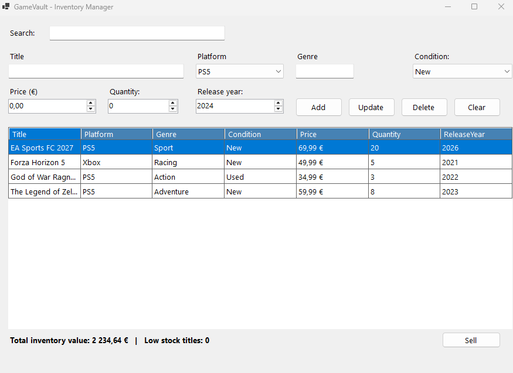

# GameVault

🇬🇧 [English](#english) | 🇵🇹 [Português](#português)

---

## English

Inventory manager for a video game store, built with C#, Windows Forms and MySQL.

**Features**

- Add, update, delete and sell games
- Search by title or platform
- Low stock highlighted in red
- Total inventory value

**Tech stack:** C# / .NET 10, Windows Forms, MySQL

**How to run**

1. Install the .NET 10 SDK and MySQL Server.
2. Clone the repo: `git clone https://github.com/YOUR_USERNAME/GameVault.git`
3. Run `database/schema.sql` in MySQL Workbench.
4. Copy `appsettings.example.json` to `appsettings.json` and set your MySQL password.
5. Open `GameVault.slnx` in Visual Studio and press **F5**.

---

## Português

Gestor de inventário para uma loja de jogos, feito com C#, Windows Forms e MySQL.

**Funcionalidades**

- Adicionar, atualizar, apagar e vender jogos
- Pesquisa por título ou plataforma
- Stock baixo destacado a vermelho
- Valor total do inventário

**Tecnologias:** C# / .NET 10, Windows Forms, MySQL

**Como executar**

1. Instala o .NET 10 SDK e o MySQL Server.
2. Clona o repositório: `git clone https://github.com/YOUR_USERNAME/GameVault.git`
3. Executa o `database/schema.sql` no MySQL Workbench.
4. Copia o `appsettings.example.json` para `appsettings.json` e coloca a tua palavra-passe do MySQL.
5. Abre o `GameVault.slnx` no Visual Studio e prime **F5**.
